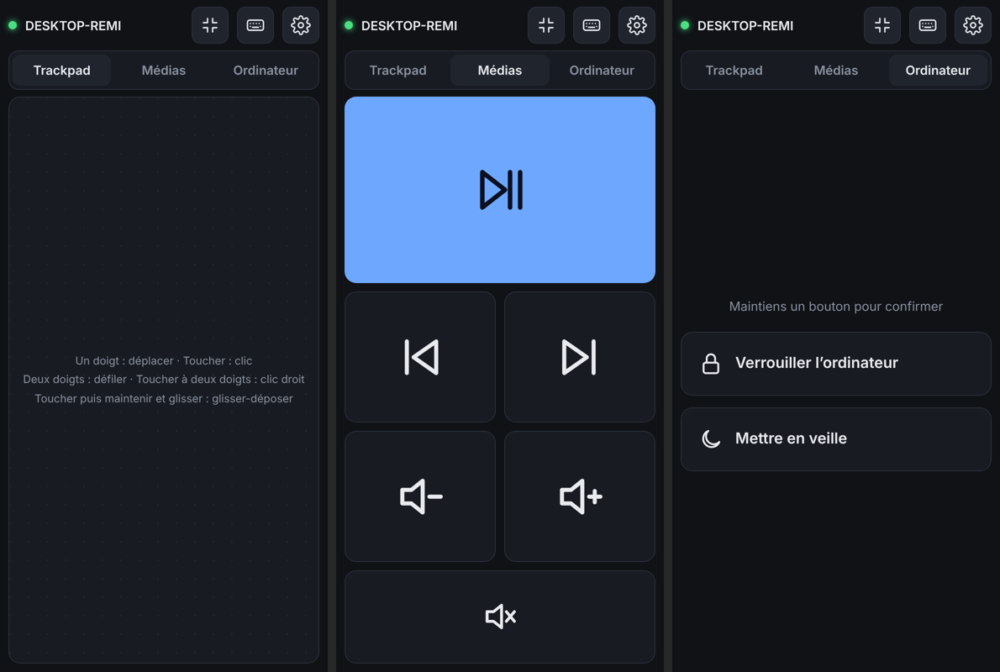

# Tapis

**Ton téléphone devient le trackpad et le clavier de ton ordinateur, uniquement via ton Wi-Fi local.**

[English](README.md)



- **Aucune appli à installer sur le téléphone.** L'ordinateur sert une petite web-app : tu scannes un QR code et c'est parti.
- **Pas d'Internet, pas de cloud, pas de compte.** Le téléphone et l'ordinateur se parlent directement sur ton réseau. La page ne charge rien de l'extérieur et le serveur refuse tout client qui n'est pas sur un réseau privé.
- **Chiffré et appairé.** TLS 1.3 avec un certificat généré sur ton ordinateur, appairage par QR code à usage unique confirmé sur l'ordinateur, une clé par téléphone, révocable. [Audité](SECURITY.md).
- **Un vrai trackpad.** Accélération du pointeur, toucher pour cliquer, défilement à deux doigts avec inertie, clic droit à deux doigts, glisser-déposer, clic milieu à trois doigts.
- **Télécommande média.** Gros boutons précédent / lecture-pause / suivant et volume dans leur propre onglet.
- **Contrôle de l'ordinateur.** Verrouiller ou mettre en veille (maintenir pour confirmer).
- **Fluide.** Le mouvement du pointeur est interpolé sur l'ordinateur : il glisse même sur un écran 144 Hz. Plein écran en un toucher.
- **Le clavier de ton téléphone.** Compatible avec la saisie prédictive et la saisie gestuelle (Gboard, SwiftKey, Samsung), les accents et les emoji, plus une barre avec Échap, Tab, Ctrl/Alt/Win/Maj, flèches, touches F, médias et volume.
- **Un seul petit binaire, zéro dépendance.** Écrit en Go avec uniquement la bibliothèque standard : facile à auditer.
- **Logiciel libre** sous licence GPL-3.0.

Ordinateurs pris en charge : **Windows 10/11** et **Linux** (X11 et tous les bureaux Wayland : GNOME, KDE, Sway, Hyprland…). Téléphones : tout navigateur Android ou iOS récent.

## Démarrage rapide

1. Télécharge `tapis` pour ton ordinateur depuis la page [Releases](../../releases) (ou [compile-le](#compiler)).
2. Lance-le dans un terminal. La première fois, il affiche un QR code.
3. Scanne le QR code avec l'appareil photo du téléphone, connecté au même Wi-Fi.
4. Le navigateur avertit que la connexion n'est pas privée. C'est normal : le certificat vient d'être généré par ton ordinateur (voir [Sécurité](#sécurité)). Touche **Paramètres avancés → Continuer**.
5. Dans la fenêtre Tapis, tape `y` puis Entrée pour autoriser le téléphone.
6. C'est tout. La prochaine fois, ouvre simplement la même adresse : le téléphone reste appairé. Astuce : « Ajouter à l'écran d'accueil » pour une appli plein écran.

Un souci ? Voir le **[guide de dépannage](DEPANNAGE.md)**.

### Gestes

| Geste | Action |
|---|---|
| Un doigt | Déplacer le pointeur |
| Toucher | Clic gauche (deux fois : double-clic) |
| Toucher, puis retoucher et glisser | Glisser-déposer (bouton gauche maintenu) |
| Deux doigts | Défiler (vertical et horizontal) |
| Toucher à deux doigts | Clic droit |
| Toucher à trois doigts | Clic milieu |

### Clavier

Touche l'icône clavier : tout ce que tu tapes part vers l'ordinateur.
Les touches de modification (Ctrl, Alt, ⊞, ⇧) s'appliquent à la touche suivante quand on les touche une fois, et restent **enfoncées** quand on les touche deux fois (pratique pour Alt+Tab : double-touche Alt, touche Tab autant de fois que nécessaire, puis retouche Alt). Avec Ctrl armé, un toucher sur le trackpad fait un Ctrl+clic.

### Commandes du terminal

Pendant que Tapis tourne, tape dans sa fenêtre :

- `p` + Entrée : nouveau QR code d'appairage (pour ajouter un téléphone)
- `d` + Entrée : liste des téléphones appairés
- `r <id>` + Entrée : désappairer un téléphone (`r all` pour tous)
- `q` + Entrée : quitter

Aussi disponibles en commandes : `tapis devices`, `tapis revoke <id|all>`, `tapis version`.
Options : `--port` (47800 par défaut), `--layout` (Linux), `--pair`, `--config`, `--no-confirm` (appairer sans confirmation sur l'ordinateur), `--no-smooth`, `--no-firewall`, `--dry-run` (affiche les événements au lieu de bouger le pointeur).

## Installation

### Windows

Lance `tapis-…-windows-amd64.exe`. Au premier lancement, Tapis configure lui-même le pare-feu Windows : Windows demande une seule fois l'autorisation administrateur, réponds **Oui**. La règle n'autorise que ce programme, sur son port, depuis ton réseau local : ça marche donc même si ton Wi-Fi est classé « Public » (`--no-firewall` pour désactiver).
Pour le démarrer avec Windows, place un raccourci dans `shell:startup`.

Windows empêche un programme normal de contrôler les fenêtres lancées en administrateur (UIPI) ainsi que les écrans Ctrl+Alt+Suppr / UAC. Lance Tapis en administrateur si tu dois contrôler ces applis.

### Linux

Tapis crée un périphérique d'entrée virtuel via `/dev/uinput` : il fonctionne donc pareil sous X11 et Wayland. Autorise ton utilisateur une fois pour toutes :

```sh
sudo cp packaging/linux/60-tapis-uinput.rules /etc/udev/rules.d/
echo uinput | sudo tee /etc/modules-load.d/uinput.conf
sudo modprobe uinput && sudo udevadm control --reload && sudo udevadm trigger
```

Puis déconnecte-toi et reconnecte-toi. Installe le binaire, par exemple `install -m755 tapis ~/.local/bin/`.
Pour le lancer avec ta session, voir [`packaging/linux/tapis.service`](packaging/linux/tapis.service).

**Disposition clavier.** uinput envoie des touches physiques : Tapis doit connaître ta disposition pour taper les caractères. Il la lit dans le système (`/etc/default/keyboard`, `/etc/vconsole.conf`) ou tu peux passer `--layout`. Intégrées : `us`, `fr`, `be` (AZERTY belge, accents circonflexes et trémas compris). Les caractères absents de ta disposition sont tapés avec la méthode Unicode Ctrl+Maj+U (applis GTK/Qt/IBus). Ajouter une disposition, c'est quelques lignes dans [`internal/input/layouts.go`](internal/input/layouts.go).

Si tu utilises `ufw`/`firewalld`, ouvre le port TCP 47800 pour ton réseau local.

## Sécurité

En bref : réseau local uniquement, TLS 1.3, autorité de certification limitée aux adresses privées, QR codes à usage unique confirmés sur l'ordinateur, une clé par téléphone, isolation web stricte, zéro dépendance, provenance des binaires signée. Le modèle de menace complet, l'audit et les limites restantes sont dans **[SECURITY.md](SECURITY.md)**.

**À propos de l'avertissement du navigateur.** Une page web ne peut pas épingler un certificat : la première fois, il faut accepter le certificat généré par Tapis. Fais-le sur ton propre réseau. Si le navigateur avertit **à nouveau** sur le même réseau sans que tu aies réinitialisé Tapis, ne continue pas.

**Supprimer l'avertissement pour de bon (recommandé).** Dans les réglages de Tapis sur le téléphone, touche **Télécharger le certificat**, puis installe-le sur Android via *Paramètres → Sécurité → … → Installer un certificat → Certificat CA* (cherche « certificat » dans les Paramètres). Dans ses détails (*Identifiants de confiance → Utilisateur*), l'empreinte SHA-256 doit correspondre à l'empreinte **Authority** affichée par Tapis au démarrage. L'autorité est limitée aux adresses privées : lui faire confiance n'affaiblit pas ta sécurité sur Internet.

**Vérifier un téléchargement :** `gh attestation verify <fichier> --repo remigl/tapis` (voir [CODE_SIGNING.md](CODE_SIGNING.md)).

Les fichiers sont dans le dossier de configuration (`%AppData%\tapis` sous Windows, `~/.config/tapis` sous Linux). Supprime-le pour tout réinitialiser.

## Compiler

Il faut Go 1.24 ou plus récent, aucune autre dépendance.

```sh
git clone https://github.com/remigl/tapis && cd tapis
go build -o tapis ./cmd/tapis                       # pour cet ordinateur
GOOS=windows GOARCH=amd64 go build ./cmd/tapis      # compilation croisée pour Windows
go test ./...
```

Pousse un tag (`git tag v0.1.0 && git push --tags`) et GitHub Actions publie les binaires Windows et Linux (x86-64 et ARM64).

## Licence

Copyright © 2026 Rémi Gladieu. Tapis est un logiciel libre : tu peux le redistribuer et/ou le modifier selon les termes de la [Licence publique générale GNU v3.0](LICENSE) ou ultérieure.
