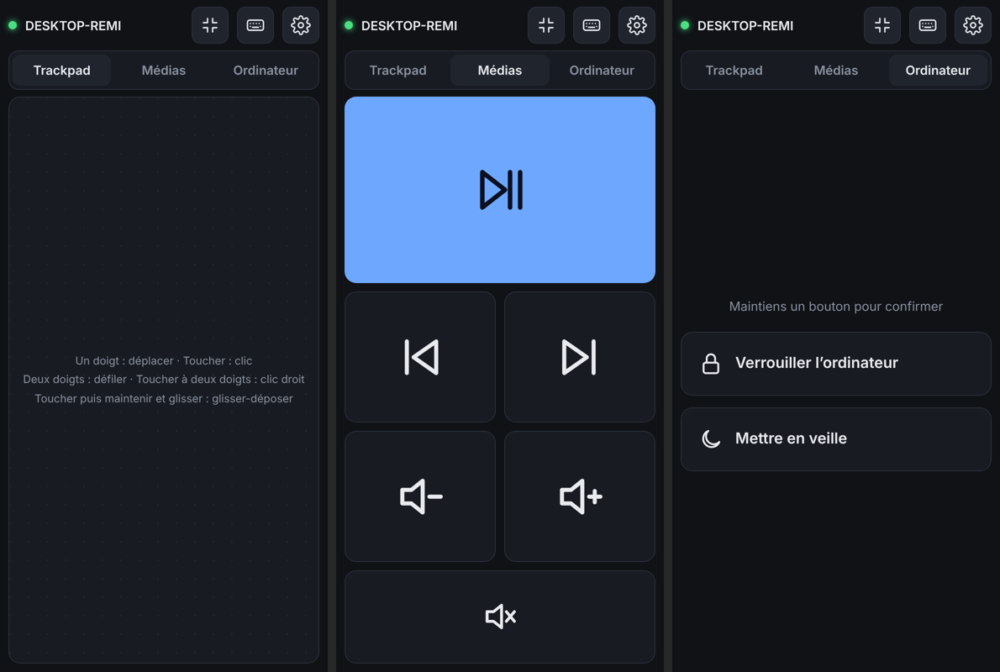

# Tapis

**Use your phone as a trackpad and keyboard for your computer, over your local Wi-Fi only.**

[Français](README.fr.md)



- **No app to install on the phone.** The computer serves a small web app; scan a QR code and you are in.
- **No Internet, no cloud, no account.** Phone and computer talk directly on your network. The page loads nothing from outside, and the server refuses any client that is not on a private network.
- **Encrypted and paired.** TLS 1.3 with a certificate generated on your computer, one-time QR pairing approved on the computer, per-phone keys you can revoke. [Audited](SECURITY.md).
- **A real trackpad.** Pointer acceleration, tap to click, two-finger scroll with inertia, two-finger tap for right click, tap-and-drag, three-finger tap for middle click.
- **Media remote.** Big previous / play-pause / next and volume buttons in their own tab.
- **Computer controls.** Lock the computer or put it to sleep (hold to confirm).
- **Smooth.** Pointer motion is interpolated on the computer, so it glides even on 144 Hz screens. Full screen in one tap.
- **Your phone's own keyboard.** Works with predictive and swipe typing (Gboard, SwiftKey, Samsung), accents and emoji, plus a bar with Esc, Tab, Ctrl/Alt/Win/Shift, arrows, F-keys, media and volume keys.
- **One small binary, zero dependencies.** Written in Go using only the standard library; easy to audit.
- **Free software** under the GPL-3.0.

Supported computers: **Windows 10/11** and **Linux** (X11 and every Wayland desktop: GNOME, KDE, Sway, Hyprland…). Phones: any recent Android or iOS browser.

## Quick start

1. Download `tapis` for your computer from the [Releases](../../releases) page (or [build it](#build-from-source)).
2. Run it in a terminal. The first time, it prints a QR code.
3. Scan the QR code with your phone camera. The phone must be on the same Wi-Fi.
4. Your browser warns that the connection is not private. This is expected: the certificate was just generated by your computer (see [Security](#security)). Tap **Advanced → Proceed**.
5. In the Tapis window, type `y` then Enter to allow the phone.
6. That's it. Next time just open the same address; the phone stays paired. Tip: "Add to Home screen" for a full-screen app.

Something doesn't work? See **[Troubleshooting](TROUBLESHOOTING.md)**.

### Gestures

| Gesture | Action |
|---|---|
| One finger | Move the pointer |
| Tap | Left click (tap twice: double click) |
| Tap, then touch again and move | Drag (hold the left button) |
| Two fingers | Scroll (vertical and horizontal) |
| Two-finger tap | Right click |
| Three-finger tap | Middle click |

### Keyboard

Tap the keyboard icon. Everything you type goes to the computer.
Modifier keys (Ctrl, Alt, ⊞, ⇧) apply to the next key when tapped once, and stay **held** when tapped twice (handy for Alt+Tab: double-tap Alt, tap Tab as many times as needed, tap Alt again). With Ctrl armed, a tap on the trackpad is a Ctrl+click.

### Terminal commands

While Tapis runs, type in its window:

- `p` + Enter: show a new pairing QR code (to add another phone)
- `d` + Enter: list paired phones
- `r <id>` + Enter: unpair a phone (`r all` for all)
- `q` + Enter: quit

Also available as commands: `tapis devices`, `tapis revoke <id|all>`, `tapis version`.
Options: `--port` (default 47800), `--layout` (Linux), `--pair`, `--config`, `--no-confirm` (pair without approval on the computer), `--no-smooth`, `--no-firewall`, `--dry-run` (print events instead of moving the pointer).

## Installation details

### Windows

Run `tapis-…-windows-amd64.exe`. On the first start Tapis configures Windows Firewall itself: Windows asks once for administrator permission, answer **Yes**. The rule only allows this program, on its port, from your local network, so it works even when your Wi-Fi is classified as "Public" (`--no-firewall` to skip this).
To start it with Windows, put a shortcut in `shell:startup`.

Windows does not let a normal program control windows running as administrator (UIPI), nor the Ctrl+Alt+Del / UAC screens. Run Tapis as administrator if you need to control elevated apps.

### Linux

Tapis creates a virtual input device through `/dev/uinput`, so it works the same on X11 and Wayland. Allow your user to use it once:

```sh
sudo cp packaging/linux/60-tapis-uinput.rules /etc/udev/rules.d/
echo uinput | sudo tee /etc/modules-load.d/uinput.conf
sudo modprobe uinput && sudo udevadm control --reload && sudo udevadm trigger
```

Then log out and back in. Install the binary, e.g. `install -m755 tapis ~/.local/bin/`.
To start it with your session, see [`packaging/linux/tapis.service`](packaging/linux/tapis.service).

**Keyboard layout.** uinput sends physical keys, so Tapis must know your layout to type characters. It reads it from the system (`/etc/default/keyboard`, `/etc/vconsole.conf`) or you can pass `--layout`. Built-in: `us`, `fr`, `be`. Characters that are not on your layout are typed with the Ctrl+Shift+U Unicode method (GTK/Qt/IBus apps). New layouts are a few lines in [`internal/input/layouts.go`](internal/input/layouts.go): contributions welcome.

If your network uses `ufw`/`firewalld`, open TCP port 47800 for your local network.

## Security

In short: local network only, TLS 1.3, a certificate authority restricted to private addresses, single-use QR codes approved on the computer, per-phone keys, strict web isolation, zero dependencies, signed release provenance. The full threat model, the audit and the remaining limits are in **[SECURITY.md](SECURITY.md)**.

**About the browser warning.** A web page cannot pin a certificate, so the first time you accept Tapis' self-generated certificate. Do it on your own network. If the browser warns **again** on the same network while you did not reset Tapis, do not continue.

**Remove the warning for good (recommended).** In Tapis settings on the phone tap **Download certificate**, then on Android install it from *Settings → Security → … → Install a certificate → CA certificate* (search "certificate" in Settings). In its details (*Trusted credentials → User*), the SHA-256 fingerprint must match the **Authority** fingerprint printed by Tapis at startup. The authority is restricted to private addresses, so trusting it does not weaken your security on the Internet.

**Verify a download:** `gh attestation verify <file> --repo remigl/tapis` (see [CODE_SIGNING.md](CODE_SIGNING.md)).

Files are in the config directory (`%AppData%\tapis` on Windows, `~/.config/tapis` on Linux). Delete it to reset everything.

## How it works

```
 phone browser ──── HTTPS (web app) ────►  tapis  ──► SendInput (Windows)
               ◄─── WebSocket / TLS 1.3 ──►        ──► /dev/uinput (Linux)
```

The phone sends small JSON messages (`move`, `scroll`, `btn`, `key`, `text`). Text is typed through a hidden text field: the app compares its content before and after each change, which is what makes predictive and swipe keyboards work.

| Path | Content |
|---|---|
| `cmd/tapis` | command-line entry point |
| `internal/server` | HTTPS server, pairing, authentication, protocol |
| `internal/input` | Windows and Linux input injection, keyboard layouts |
| `internal/ws` | minimal WebSocket implementation (RFC 6455) |
| `internal/qr` | minimal QR Code encoder |
| `internal/certs` | local certificate authority |
| `internal/store` | paired devices |
| `web/static` | phone web app (HTML, CSS, JS, no framework) |

## Build from source

Requires Go 1.24 or newer. No other dependency.

```sh
git clone https://github.com/remigl/tapis && cd tapis
go build -o tapis ./cmd/tapis                       # this computer
GOOS=windows GOARCH=amd64 go build ./cmd/tapis      # cross-compile for Windows
go test ./...
```

Tag a version (`git tag v0.1.0 && git push --tags`) and GitHub Actions publishes binaries for Windows and Linux (x86-64 and ARM64).

## Roadmap ideas

macOS backend (Quartz events) · tray icon · mDNS discovery (`tapis.local`) · more keyboard layouts · pinch-to-zoom (Ctrl+wheel) · three-finger swipes.

## License

Copyright © 2026 Rémi Gladieu. Tapis is free software: you can redistribute it and/or modify it under the terms of the [GNU General Public License v3.0](LICENSE) or later.
